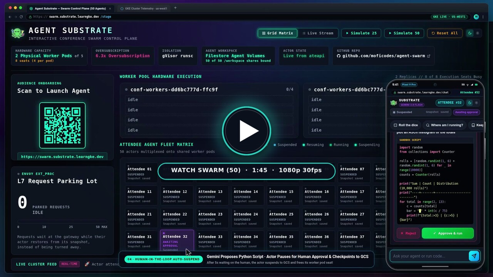
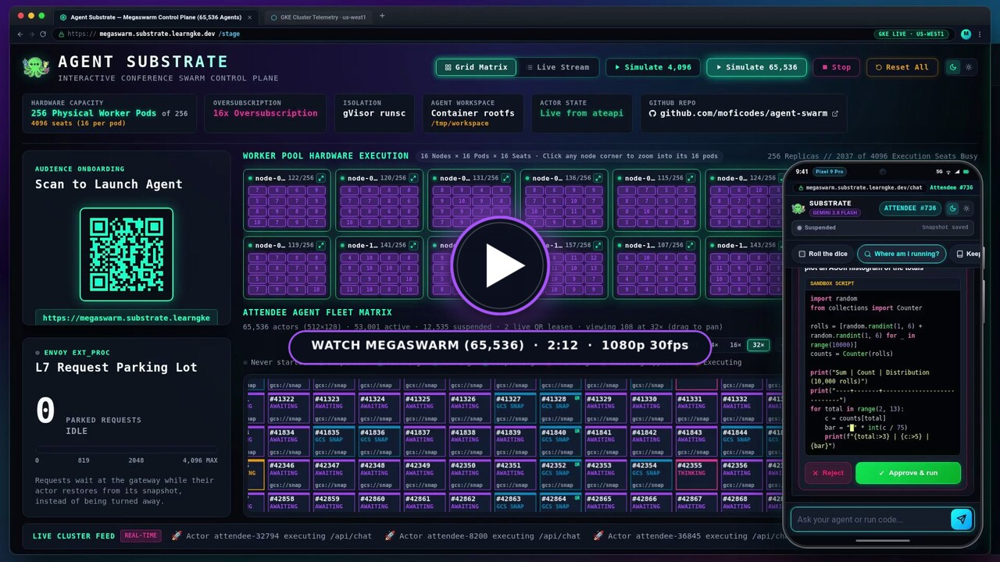
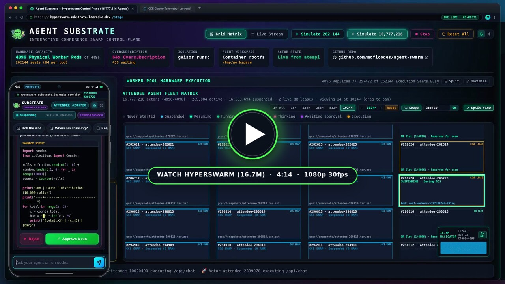

<!--
Copyright 2026 Google LLC

Licensed under the Apache License, Version 2.0 (the "License");
you may not use this file except in compliance with the License.
You may obtain a copy of the License at

    http://www.apache.org/licenses/LICENSE-2.0

Unless required by applicable law or agreed to in writing, software
distributed under the License is distributed on an "AS IS" BASIS,
WITHOUT WARRANTIES OR CONDITIONS OF ANY KIND, either express or implied.
See the License for the specific language governing permissions and
limitations under the License.
-->

# Live Demo Video Recordings (`50 → 65,536 → 16,777,216` Agents)

All three `1920×1080` (`30fps`, H.264) videos were recorded live against the three GKE deployments (`swarm`, `megaswarm`, and `hyperswarm` profiles on Agent Substrate `v1.0.0`), showing **both** the Stage Control Plane (`/stage`) inside a macOS Chrome browser window and the Attendee Mobile UI (`/chat`) inside a floating Google Pixel 9 Pro Picture-in-Picture overlay interacting in real time.

Each video is silent with self-contained on-screen chapter title cards, lower-third HUD callout banners, glowing spotlight callout pills, smooth full-frame optical camera zooms (`1.55×–1.75×`), and cursor highlight gestures so they can be embedded directly in slide decks or narrated live on stage.

| Tier | Scale | Worker Topology | Duration | Size | Video | Direct Download |
| :--- | :--- | :--- | :--- | :--- | :--- | :--- |
| **Level 1 · Swarm** | `50` actors | `2–5` worker pods (`4` seats/pod) | `1m 44.7s` | `22.3 MB` | [`swarm.mp4`](swarm.mp4) | [Download raw MP4](https://github.com/moficodes/agent-swarm/raw/main/docs/demos/swarm.mp4) |
| **Level 2 · Megaswarm** | `65,536` actors ($16^4$) | `256` worker pods (`16 × 16 × 16` = `4,096` seats) | `2m 11.6s` | `37.5 MB` | [`megaswarm.mp4`](megaswarm.mp4) | [Download raw MP4](https://github.com/moficodes/agent-swarm/raw/main/docs/demos/megaswarm.mp4) |
| **Level 3 · Hyperswarm** | `16,777,216` actors ($64^4$) | `4,096` worker pods (`64 × 64 × 64` = `262,144` seats) | `4m 14.0s` | `57.8 MB` | [`hyperswarm.mp4`](hyperswarm.mp4) | [Download raw MP4](https://github.com/moficodes/agent-swarm/raw/main/docs/demos/hyperswarm.mp4) |

---

## Level 1 · Swarm (`50` Sandboxed Agents · Filestore `/workspace`)

- **Key moments**:
  - **0:00 – 0:17**: Clean post-slate reveal and Projector Light/Dark theme toggle.
  - **0:17 – 0:20**: Regional Filestore Agent Volumes `/workspace` lazy mount spotlight (`50 of 50 /workspace shares bound`, `~130ms` lazy mount).
  - **0:24 – 0:40**: Google Pixel 9 Pro `/chat` prompt chip interaction and live `/stage` actor state transition (`Resuming → Thinking` with Gemini 3.8 Flash on the Gemini platform).
  - **0:45 – 0:52**: Human-in-the-loop auto-suspend zoom + spotlight (`Checkpointed to GCS · 0 Pod CPU While Waiting`).
  - **0:58 – 1:13**: Pixel 9 Pro `Approve & run` execution in gVisor (`runsc`), output zoom, and Actor Spotlight Drawer inspection.
  - **1:25 – 1:44**: `Simulate 50` burst triggering the Envoy L7 Request Parking Lot (`#parking-meter`) zoom and Live Stream view.

[Open `swarm.mp4`](swarm.mp4) · [Download raw MP4 (`22.3 MB`)](https://github.com/moficodes/agent-swarm/raw/main/docs/demos/swarm.mp4)

---

## Level 2 · Megaswarm (`65,536` Agents · $16^4$ · `16×` Hardware Oversubscription)

- **Key moments**:
  - **0:18 – 0:26**: Live oversubscription spotlight (`~53,000+` active agents multiplexed onto `4,096` physical seats across `256` worker pods, `0` crashed) and Envoy L7 Request Parking Lot zoom.
  - **0:40 – 1:00**: 3-level hardware topology drill-down with smooth zooms: `All 16 Nodes → Node 1 (16 Worker Pods) → Pod 1 (16 Individual Actor Seat Cards)`.
  - **1:16 – 1:21**: `512×128` Fleet Matrix with zoomed `10×` Floating Magnifier Loupe sweep and `1× → 4× → 16× → 32×` semantic zoom + `65K Navigator` minimap pan.
  - **1:38 – 2:06**: Live `/chat` turn on reserved `id % 16 == 0` human slot (`Attendee #736`), zooming cleanly between the Google Pixel 9 Pro proposed Python script, the `32×` live actor card on `/stage`, and `Approve & run` gVisor execution.

[Open `megaswarm.mp4`](megaswarm.mp4) · [Download raw MP4 (`37.5 MB`)](https://github.com/moficodes/agent-swarm/raw/main/docs/demos/megaswarm.mp4)

---

## Level 3 · Hyperswarm (`16,777,216` Agents · $64^4$ · `64×` Oversubscription)

- **Key moments**:
  - **0:19 – 0:30**: Dual spotlights on `4,096` worker pods (`262,144` gVisor seats packed to `63–64/64` active seats per pod) and `64×` oversubscription (`16.46M+` checkpointed actors in Cloud Storage), followed by the Envoy L7 Request Parking Lot (`65,536 MAX`) zoom.
  - **0:48 – 1:11**: `64 × 64 × 64` hardware topology drill-down with smooth zooms into Node 1's `64` worker pods, Pod `579fc86746-292sq`'s `64/64` active gVisor seats, and an automated actor's Spotlight Drawer.
  - **1:40 – 1:45**: `4,096 × 4,096` WebGL2 `R8UI` Fleet Matrix with zoomed `10×` Floating Magnifier Loupe sweep and full `1× → 16× → 128× → 256× → 512× → 1024×` semantic zoom.
  - **2:02 – 3:42**: Live two-phase `/chat` turn on reserved `4,096`-stride human slot `Attendee #286720`, zooming directly onto the unobstructed `1024×` inspector card across every state transition:
    1. `LIVE LEASE · GCS SNAP` → Pixel 9 Pro prompt chip click → `RESUMING` → `THINKING · Gemini Turn` (`2:12–2:17`)
    2. Pixel 9 Pro proposed Python script (`2:21–2:25`) → mandatory Phase 1 GCS suspend `SUSPENDING · Saving GCS` → `AWAITING · Approval (GCS)` with `0` Pod RAM (`2:37–2:41`) + Actor Spotlight Drawer inspection (`2:46–2:50`)
    3. Pixel 9 Pro `Approve & run` → `RESUMING` → `EXECUTING · Tool Call` (`3:04–3:09`) → Pixel 9 Pro gVisor output zoom (`3:10–3:15`)
    4. Mandatory Phase 2 idle suspend → `GCS SNAP · Suspended (0 RAM)` spotlight (`3:28–3:32`) + Actor Spotlight Drawer inspection (`3:38–3:42`).

[Open `hyperswarm.mp4`](hyperswarm.mp4) · [Download raw MP4 (`57.8 MB`)](https://github.com/moficodes/agent-swarm/raw/main/docs/demos/hyperswarm.mp4)
